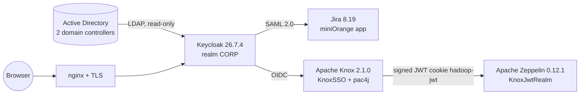

# enterprise-sso-keycloak

> **One login for the whole company.** A documented, reproducible blueprint for Keycloak single sign-on federated to Active Directory, connected to Jira (SAML), Apache Knox and Apache Zeppelin (OIDC and signed JWT) — with masked configs, deployment scripts, UI runbooks, **every bug we hit and how it was fixed**, and an honest list of what is still open.


This repository is the write-up of a real build. Everything specific to the original company (domain, hosts, IPs, DNs, users, secrets) has been replaced by placeholders. See [docs/prerequisites.md](docs/prerequisites.md#masking-conventions).

## What was built



| Phase | What | Where to read | Automation |
|---|---|---|---|
| 1 | Keycloak on Rocky Linux 9 + PostgreSQL + nginx | [docs/keycloak/deployment.md](docs/keycloak/deployment.md) | [`scripts/keycloak/`](scripts/keycloak) |
| 1b | Keycloak admin and realm | [docs/keycloak/ui-steps.md](docs/keycloak/ui-steps.md) | UI only |
| 2 | Active Directory federation | [docs/keycloak/ad-federation.md](docs/keycloak/ad-federation.md) | UI only (+ PowerShell snippet) |
| 3 | Jira via SAML | [docs/services/jira.md](docs/services/jira.md) | UI only |
| 4 | Knox gateway + Keycloak OIDC | [docs/services/knox.md](docs/services/knox.md) | [`scripts/knox/`](scripts/knox) |
| 5 | Zeppelin via Knox JWT | [docs/services/zeppelin.md](docs/services/zeppelin.md) | [`scripts/zeppelin/`](scripts/zeppelin) |

Cross-cutting documents:

- [Architecture](docs/architecture.md) — how the pieces fit and why
- [Troubleshooting: 23 problems and fixes](docs/troubleshooting.md)
- [Post-install changes, workarounds and deliberate shortcuts](docs/post-install-changes.md) — the "what we changed after install and why" list
- [Known limitations and open work](docs/known-limitations.md)
- [Security checklist before going public or wider](docs/security-checklist.md)
- [Adding a new service](docs/adding-a-service.md) and the [roadmap](docs/roadmap.md) (Grafana, GitLab, Ranger, Nextcloud, ...)
- [The original Word guide](docs/guide/) (same content in one document)

## Quick start

```bash
git clone https://github.com/<you>/enterprise-sso-keycloak.git && cd enterprise-sso-keycloak
cp config/env/sso.env.example config/env/sso.env     # edit names, paths; no secrets in it
sudo bash scripts/keycloak/deploy-all.sh             # phase 1 (asks for passwords interactively)
# then follow docs/keycloak/ui-steps.md, ad-federation.md, services/*.md in order
```

> **Honesty note.** The scripts were reconstructed from the manual steps that were actually performed and were syntax-checked and template-tested, but **not run end to end on a clean machine**. Read each script before running it; they are short on purpose. Anything not verified is labelled *unverified* in the docs.

## Repository layout

```
config/        masked, templated config files (*.example, ${VARS} filled in by scripts)
scripts/       numbered, idempotent where possible; lib/ has shared helpers; tools/ has checks
docs/          one document per phase/service + cross-cutting docs
.github/       CI: shell checks, template rendering, secret scan
```

## Safety rules for contributors

1. Never commit real values. Run `bash scripts/tools/check-secrets.sh` before every commit; put your real domain/hosts in the git-ignored `.forbidden-terms` file so the scan blocks them.
2. Label unverified statements as such.
3. Every bug and every workaround goes into [troubleshooting](docs/troubleshooting.md) / [post-install-changes](docs/post-install-changes.md).

See [CONTRIBUTING.md](CONTRIBUTING.md) and [SECURITY.md](SECURITY.md).

## License

MIT — see [LICENSE](LICENSE).
