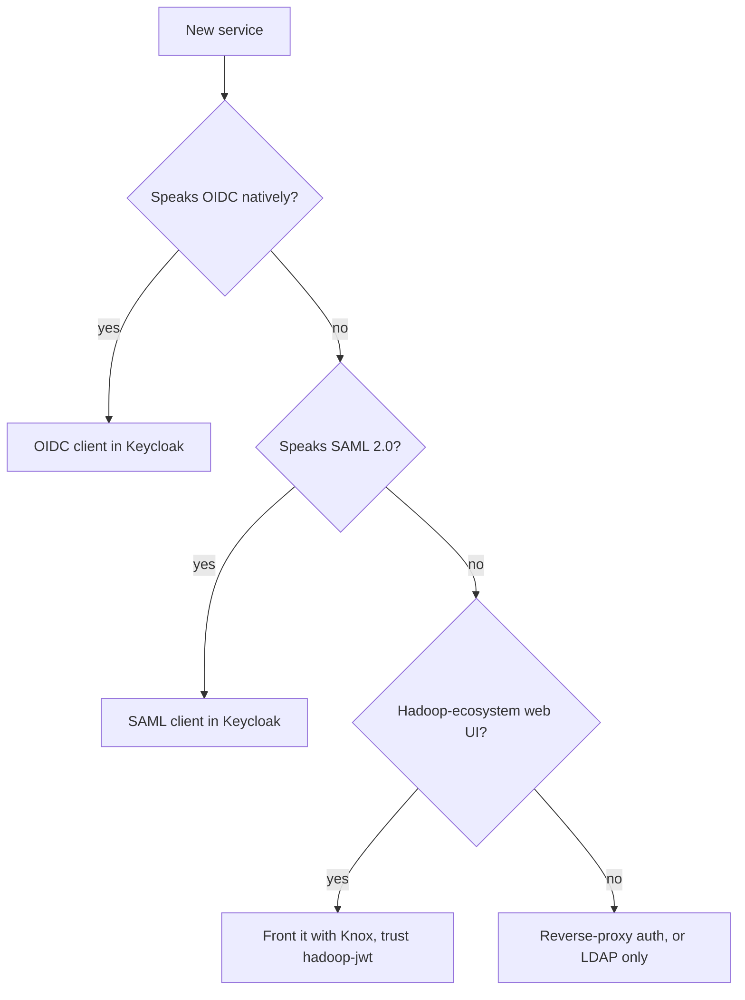

# Adding a new service to the SSO

This repository is meant to grow: GitLab, Dundas, further Hadoop web UIs, ... The recipe below is the one used for Jira, Knox, Zeppelin, Ranger, Grafana and Nextcloud.

## 0. Decide how the service will authenticate

Prefer OIDC when both exist (simpler, easier logout). Check the **exact version** of the product: support differs by edition and release (this is what ruled out Kantega for Jira and direct OIDC for Zeppelin 0.12.1). And look for a **built-in integration first**: Ranger's Knox filter and Grafana's generic OAuth needed no code at all. If the product has *no* third-party sign-in setting and an old version, **stop and write it down**: [Exchange 2016](services/exchange.md) was evaluated and left alone, which was the right outcome.

| Service | Method | Why |
|---|---|---|
| Jira | SAML through a marketplace app | no native OIDC in this version |
| Zeppelin, Ranger | Knox JWT cookie | Hadoop-ecosystem UIs with a built-in Knox filter |
| Grafana | OIDC, generic OAuth | native, roles from a `groups` claim |
| Nextcloud | OIDC through `user_oidc`, accounts stay in LDAP | native app; **existing accounts** make user-ID matching the whole problem |
| Exchange 2016 | none | no third-party provider setting, no modern authentication |

## 1. Checklist (copy into your PR)

1. DNS record + TLS certificate (wildcard already covers `*.example.corp`).
2. Keycloak client (OIDC: confidential, standard flow, exact redirect URI; SAML: entity ID = SP entity ID, ACS URL, signing). Record every field.
3. Service-side configuration; put a **masked template** in `config/<service>/*.example`.
4. **Username mapping** decided up front: `preferred_username` / `sAMAccountName` vs e-mail. (Jira's duplicate-account problem came from this.) **If accounts already exist** in the service, find out *exactly* what its internal user ID is (a GUID in upper case, in Nextcloud's case) and send that, in that case. Run the first test with **automatic account creation off**, so a wrong match fails instead of creating duplicates.
5. **Who may log in:** group/role requirement from day one — do not repeat gap A3 in [post-install-changes](post-install-changes.md).
6. **Logout test:** log in, log out in the service, open the service again in the same browser. If you are logged straight back in, find which session survived. **Three sessions** can be alive (the application's, Knox's cookies, Keycloak's): the test only passes when you can sign in as a *different* user afterwards. Behind Knox, give the application its own logout address (`scripts/tools/gen-app-logout.sh`) and add its return address to the client's *Valid post logout redirect URIs*. For a service that talks to Keycloak directly, set its own sign-out address instead.
7. **Break-glass:** keep exactly one login that works without SSO, test it, and add the service to [break-glass.md](break-glass.md). If the product allows no local login, write down the server-side recovery.
8. **Secrets in containers:** pass a client secret through the mechanism the platform really supports. `docker stack deploy` does **not** read a `.env` file (problem 31); a Docker secret keeps the value out of `docker service inspect`.
9. Document bugs → [troubleshooting](troubleshooting.md); shortcuts → [post-install-changes](post-install-changes.md); gaps → [known-limitations](known-limitations.md).
10. Run `bash tests/run-tests.sh` (rendering, ShellCheck, link check, secret scan).

Start from [`docs/services/_TEMPLATE.md`](services/_TEMPLATE.md).

## 2. Conventions

- Scripts: `scripts/<service>/NN-name.sh`, source `lib/common.sh`, ask for secrets with `require_secret`, never write secrets into the repo.
- Configs: `config/<service>/<name>.example` with `${VARS}`; add new variables to `RENDER_VARS` in `scripts/lib/common.sh` and `config/env/sso.env.example`.
- When a service needs a small tool (an XML editor, a patcher), put it under `scripts/lib/` or `scripts/<service>/`, make it **idempotent**, make it refuse when its anchor is not found exactly once, and add a fixture test in `tests/`.
- Keep the README phase table and [roadmap](roadmap.md) in sync.
