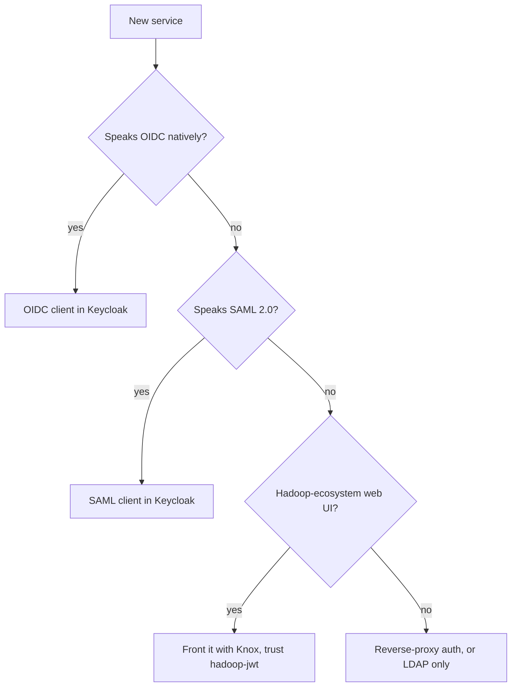

# Adding a new service to the SSO

This repository is meant to grow: Grafana, GitLab, Ranger, Nextcloud, Dundas, ... The recipe below is the same one used for Jira, Knox and Zeppelin.

## 0. Decide how the service will authenticate

Prefer OIDC when both exist (simpler, easier logout). Check the **exact version** of the product: support differs by edition and release (this is what ruled out Kantega for Jira and direct OIDC for Zeppelin 0.12.1).

## 1. Checklist (copy into your PR)

1. DNS record + TLS certificate (wildcard already covers `*.example.corp`).
2. Keycloak client (OIDC: confidential, standard flow, exact redirect URI; SAML: entity ID = SP entity ID, ACS URL, signing). Record every field.
3. Service-side configuration; put a **masked template** in `config/<service>/*.example`.
4. **Username mapping** decided up front: `preferred_username` / `sAMAccountName` vs e-mail. (Jira's duplicate-account problem came from this.)
5. **Who may log in:** group/role requirement from day one — do not repeat gap A3 in [post-install-changes](post-install-changes.md).
6. **Logout test:** log in, log out in the service, open the service again in the same browser. If you are logged straight back in, find which session survived.
7. Document bugs → [troubleshooting](troubleshooting.md); shortcuts → [post-install-changes](post-install-changes.md); gaps → [known-limitations](known-limitations.md).
8. Run `scripts/tools/check-secrets.sh`.

Start from [`docs/services/_TEMPLATE.md`](services/_TEMPLATE.md).

## 2. Conventions

- Scripts: `scripts/<service>/NN-name.sh`, source `lib/common.sh`, ask for secrets with `require_secret`, never write secrets into the repo.
- Configs: `config/<service>/<name>.example` with `${VARS}`; add new variables to `RENDER_VARS` in `scripts/lib/common.sh` and `config/env/sso.env.example`.
- Keep the README phase table and [roadmap](roadmap.md) in sync.
