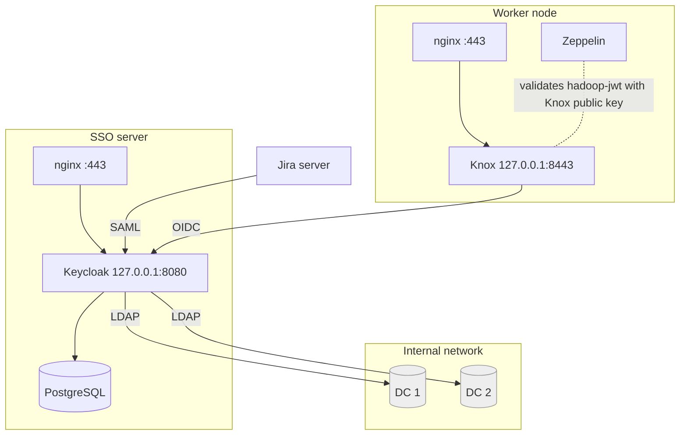
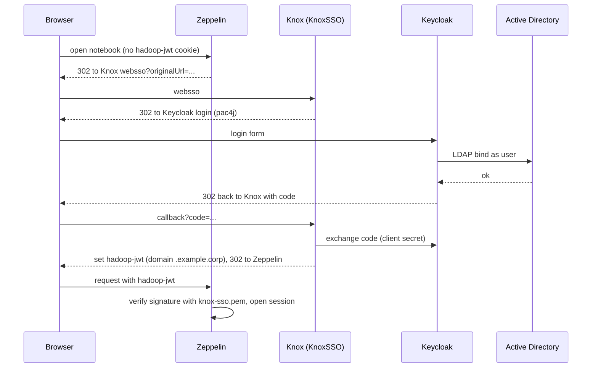

# Architecture

Three ideas shape the design:

1. **Passwords live in one place only: Active Directory.** Keycloak checks a password by binding to AD as the user; nothing is copied.
2. **Keycloak is the single broker.** Applications never talk to AD; they redirect users to Keycloak and receive a signed statement of who the user is.
3. **Apache Knox adapts the Hadoop world.** Most Hadoop web tools cannot speak OIDC or SAML, but they can validate a Knox-signed token.

## Trust relationships

| Link | Protocol | What travels | Details |
|---|---|---|---|
| Keycloak ↔ AD | LDAP (plain at present) | bind as user to check password; read-only service account for attributes | [ad-federation](keycloak/ad-federation.md) |
| Jira ↔ Keycloak | SAML 2.0 via miniOrange app | signed assertion with the user name | [jira](services/jira.md) |
| Knox ↔ Keycloak | OIDC (pac4j), authorisation code flow, confidential client | code → identity → Knox-signed token | [knox](services/knox.md) |
| Zeppelin ↔ Knox | JWT in cookie `hadoop-jwt` | signature checked with Knox public key; Zeppelin never talks to Keycloak | [zeppelin](services/zeppelin.md) |
| Browser ↔ every host | HTTPS via nginx | TLS ends at nginx with a public wildcard certificate | [keycloak/deployment](keycloak/deployment.md) |

## Login sequence for Zeppelin (the longest chain)

## Sessions you have to think about (important for logout)

A signed-in user has **three** independent sessions: the Keycloak session, Knox's `pac4j.session.*` cookies, and Knox's `hadoop-jwt`. Ending only one of them silently signs the user back in. See [services/knox.md](services/knox.md#logout) and [services/zeppelin.md](services/zeppelin.md#logout).

## Why this shape

A new application needs one client definition in Keycloak and **no change on the domain controllers**. Login policy (MFA, password rules, session lifetime) lives in one place. The price is an extra hop through Knox for Hadoop tools and a more involved logout.
