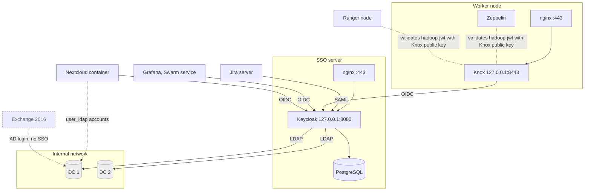
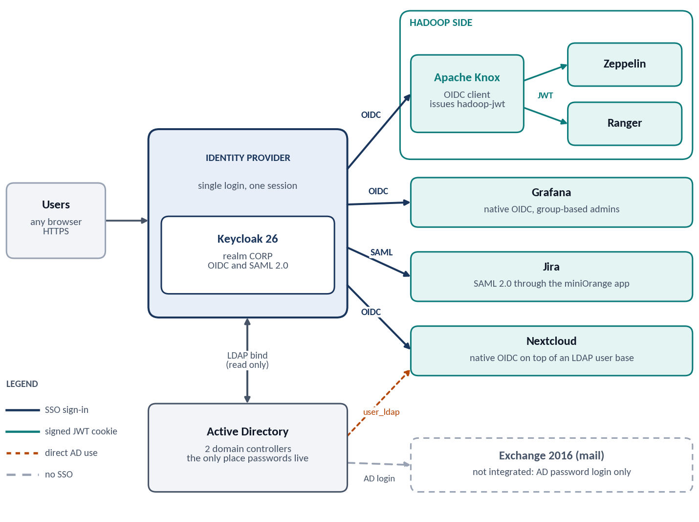
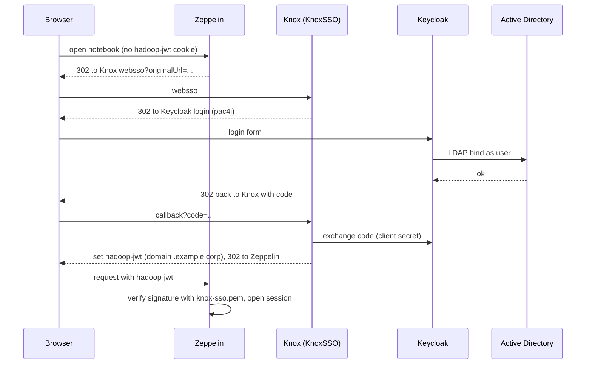
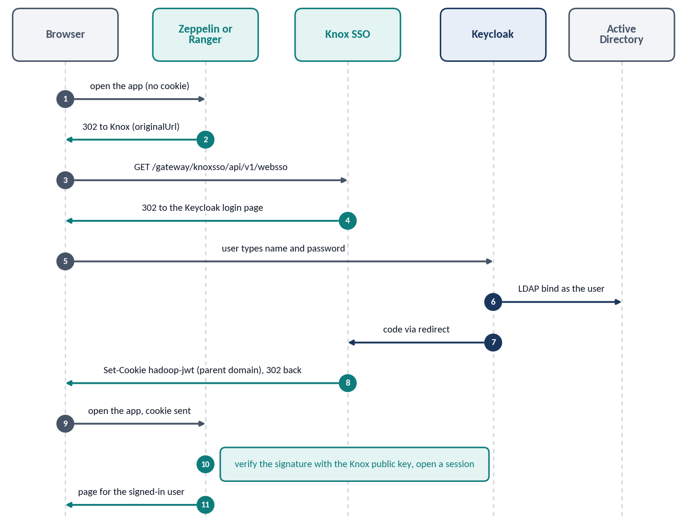
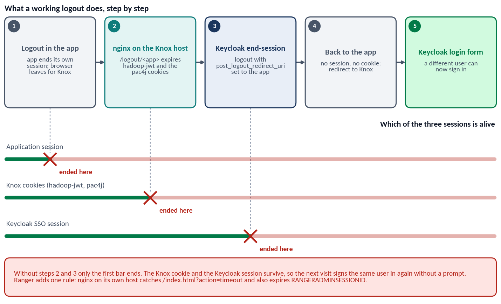
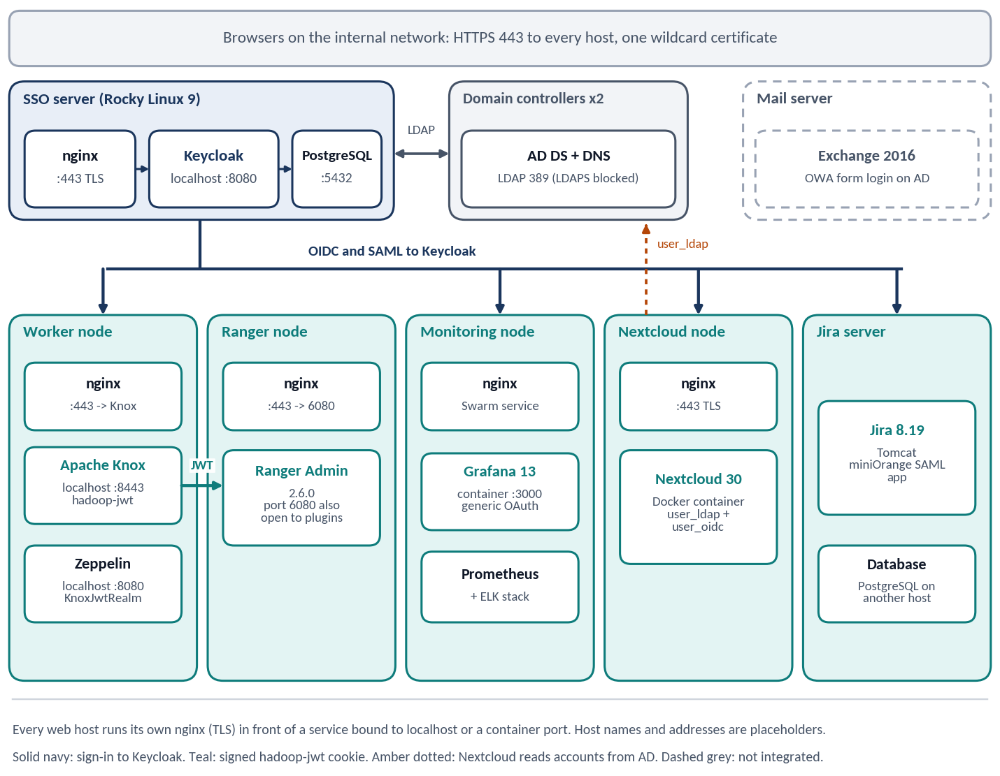

# Architecture

Four ideas shape the design:

1. **Passwords live in one place only: Active Directory.** Keycloak checks a password by binding to AD as the user; nothing is copied.
2. **Keycloak is the single broker.** Applications never talk to AD for sign-in; they redirect users to Keycloak and receive a signed statement of who the user is.
3. **Apache Knox adapts the Hadoop world.** Most Hadoop web tools cannot speak OIDC or SAML, but they can validate a Knox-signed token: Zeppelin and Ranger work this way.
4. **Applications that speak a standard protocol talk to Keycloak directly** (Grafana and Nextcloud use OpenID Connect, Jira uses SAML). Nothing in between.

## Trust relationships

| Link | Protocol | What travels | Details |
|---|---|---|---|
| Keycloak ↔ AD | LDAP (plain at present) | bind as user to check password; read-only service account for attributes | [ad-federation](keycloak/ad-federation.md) |
| Jira ↔ Keycloak | SAML 2.0 via miniOrange app | signed assertion with the user name | [jira](services/jira.md) |
| Knox ↔ Keycloak | OIDC (pac4j), authorisation code flow, confidential client | code → identity → Knox-signed token | [knox](services/knox.md) |
| Zeppelin ↔ Knox | JWT in cookie `hadoop-jwt` | signature checked with Knox public key; Zeppelin never talks to Keycloak | [zeppelin](services/zeppelin.md) |
| Ranger ↔ Knox | JWT in cookie `hadoop-jwt` | same as Zeppelin; Ranger holds its own copy of the Knox certificate | [ranger](services/ranger.md) |
| Grafana ↔ Keycloak | OIDC (generic OAuth), authorisation code flow with PKCE | the `groups` claim decides who is an administrator | [grafana](services/grafana.md) |
| Nextcloud ↔ Keycloak | OIDC through the `user_oidc` app | the AD GUID as user ID; the accounts themselves stay in LDAP | [nextcloud](services/nextcloud.md) |
| Exchange | none | evaluated; AD password login kept | [exchange](services/exchange.md) |
| Browser ↔ every host | HTTPS via nginx | TLS ends at nginx with a public wildcard certificate | [keycloak/deployment](keycloak/deployment.md) |

## Login sequence for Zeppelin (the longest chain)

Ranger follows exactly the same sequence; only the application at the start differs. Grafana and Nextcloud skip Knox and send the browser to Keycloak themselves.

## Sessions you have to think about (important for logout)

A signed-in user has **three** independent sessions: the Keycloak session, Knox's `pac4j.session.*` cookies, and Knox's `hadoop-jwt`. Ending only one of them silently signs the user back in. A working logout ends all three ([one logout address per application](services/knox.md#one-logout-address-per-application)); see also [services/zeppelin.md](services/zeppelin.md#logout) and [services/ranger.md](services/ranger.md#4-logout). Grafana and Nextcloud talk to Keycloak directly, so for them the sign-out address in their own settings ends the Keycloak session.

## Deployment topology

Every web host runs its own nginx (TLS, one wildcard certificate) in front of a service bound to localhost or a container port. Host names and addresses are placeholders ([masking conventions](prerequisites.md#masking-conventions)).

## What happens when SSO is down

Every sign-in depends on Active Directory, Keycloak, Knox and nginx. [Break-glass access](break-glass.md) lists, per service, the login that works without them.

## Why this shape

A new application needs one client definition in Keycloak and **no change on the domain controllers**. Login policy (MFA, password rules, session lifetime) lives in one place. The price is an extra hop through Knox for Hadoop tools and a more involved logout.
