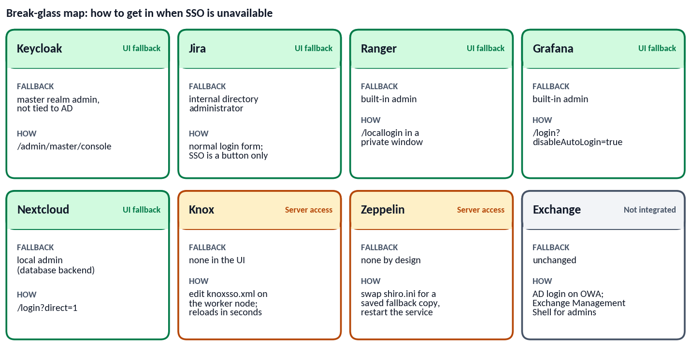

# Break-glass access: getting in when SSO is unavailable

Single sign-on adds dependencies. Active Directory, Keycloak, Knox and nginx must all work before anyone can sign in. A **break-glass path** is a credential stored *in the application itself* that works without them — or, where the product allows no local login, a documented server-side recovery. These paths are for **outages and recovery, not for daily use**.



## Rules

1. **Long random passwords, stored offline** (a sealed envelope or a vault *outside* the systems they unlock) — never in this repository or in a document.
2. **Exactly one account per service**, named so its use stands out in the logs. Look at the log entries whenever one is used.
3. **Test every path after each upgrade.** Most fallbacks depend on a URL parameter or a setting an upgrade can change. [`check-breakglass.sh`](../scripts/tools/check-breakglass.sh) tests that the pages answer; **only a human can test the password**.
4. **Keep the fallback addresses behind the same network controls as the application.** Several sit on the normal host name.
5. **Do not remove local login "for security" without a tested replacement.** The fallback is what turns an outage into a nuisance instead of an incident.

## Summary by service

| Service | Fallback | Where | Depends on | Status |
|---|---|---|---|---|
| Keycloak | master realm administrator (not tied to AD) | `https://<SSO_HOSTNAME>/admin/master/console/` | PostgreSQL and nginx only | admin created in [ui-steps](keycloak/ui-steps.md#1-permanent-administrator); lost-admin recovery **not tested** |
| Jira | internal-directory administrator on the normal form (SSO is only the *Use Corporate Login* button) | `https://<JIRA_HOSTNAME>/login.jsp` | Jira only | kept by design ([jira.md](services/jira.md)) |
| Ranger | built-in `admin` | `https://<RANGER_HOSTNAME>/locallogin`, in a **private window** | Ranger database | **verified** ([ranger.md](services/ranger.md#5-access-control)) |
| Grafana | built-in `admin` | `https://<GRAFANA_HOSTNAME>/login?disableAutoLogin=true` | Grafana database | parameter name **unverified**: retest after upgrades |
| Nextcloud | local `admin` (Database backend) | `https://<NEXTCLOUD_HOSTNAME>/login?direct=1` | Nextcloud database | account exists; address taken from the integration notes, **unverified** |
| Knox | **none in the UI** (the home page trusts only SSO) | edit `knoxsso.xml` on the worker node; Knox redeploys a changed topology on its own | server access | **not tested** |
| Zeppelin | **none by design** (`[users]` in `shiro.ini` is empty) | swap in a saved fallback `shiro.ini`, restart | server access | **not tested** |
| Exchange | unchanged | AD login on OWA; Exchange Management Shell for administration | Active Directory | not part of SSO |

## Procedures

### Zeppelin — no local user, so replace the configuration for as long as needed

```bash
cp <ZEPPELIN_HOME>/conf/shiro.ini <ZEPPELIN_HOME>/conf/shiro.ini.sso
cp <ZEPPELIN_HOME>/conf/shiro.ini.template <ZEPPELIN_HOME>/conf/shiro.ini
# edit [users]: delete the sample users, keep ONE line:  admin = <PASSWORD>, admin
systemctl restart zeppelin
# when finished:
cp <ZEPPELIN_HOME>/conf/shiro.ini.sso <ZEPPELIN_HOME>/conf/shiro.ini && systemctl restart zeppelin
```

While the fallback file is in place **password login is open** on Zeppelin. Switch back as soon as possible. **Unverified:** this procedure was not run.

### Knox

Keep a copy of the working `knoxsso.xml` beside the live file. A corrected topology file takes effect **within seconds, without a restart**.

### Ranger

Open `https://<RANGER_HOSTNAME>/locallogin` in a private window and sign in as `admin`. If the page redirects to Knox instead, a `hadoop-jwt` cookie from an earlier session is still present: use a private window.

### Grafana and Nextcloud — a lost local password

```bash
docker exec -it $(docker ps -qf name=<stack>_grafana) grafana cli admin reset-admin-password '<PASSWORD>'
docker exec -it -u www-data app php occ user:resetpassword admin
```

**Unverified:** neither command was run in this build.

### Keycloak

If the master realm administrator is lost, the Keycloak 26 command line can create a new one (`bin/kc.sh bootstrap-admin user`). Check the exact syntax for your version **before** an outage, not during one. **Unverified.**

## What a break-glass login must never become

A fallback nobody tests rots, and a fallback everybody uses defeats the purpose of SSO: no central disable, no password policy, no audit trail. If one of these accounts is used outside an outage, treat it as an incident, change the password, and find out why.
