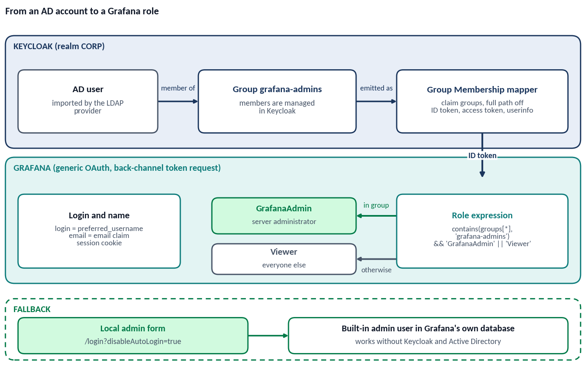

# Grafana — OpenID Connect integration

**Status:** working   **Version:** 13.2.0 (Docker Swarm stack)   **Protocol:** OIDC (generic OAuth), authorisation code flow with PKCE
**Automation:** [`scripts/grafana/`](../../scripts/grafana/) — `01-deploy-stack` → `02-verify`; templates in [`config/grafana/`](../../config/grafana/)

Grafana runs as a Docker Swarm service next to Prometheus, node-exporter and the log stack; nginx is a Swarm service too and serves `GRAFANA_HOSTNAME`. Grafana speaks OpenID Connect itself, so it talks to **Keycloak directly — Knox is not involved**. Members of one Keycloak group become Grafana server administrators; everybody else who signs in is a Viewer. The built-in `admin` form stays as the fallback.



## Why this service, why this method

Grafana's generic OAuth provider is a first-class, documented feature, so the choice was never in doubt: no adapter, no plug-in, no patch. Roles are decided from a **claim**, not from a local list, so adding an administrator is one group-membership change in Keycloak.

## Prerequisites

- A Docker Swarm manager and an overlay network shared with nginx (`elk` in the original build), DNS and certificate for `GRAFANA_HOSTNAME`.
- The nginx server block: [`config/nginx/dashboards.conf.example`](../../config/nginx/dashboards.conf.example).
- A Keycloak realm with the AD provider ([phase 2](../keycloak/ad-federation.md)).
- This node needs outbound access to Keycloak (`SSO_HOSTNAME`) **from inside the container**: Grafana's server, not the browser, exchanges the code for a token. Check with `docker exec <container> wget -qO- https://<SSO_HOSTNAME>/realms/<REALM>/.well-known/openid-configuration | head -c 200`.

## 1. Keycloak side

| Setting | Value |
|---|---|
| Client ID | `grafana` |
| Client type | OpenID Connect, **Client authentication on** (confidential), standard flow only |
| Root URL | `https://<GRAFANA_HOSTNAME>` |
| Valid redirect URIs | `https://<GRAFANA_HOSTNAME>/login/generic_oauth` |
| Valid post logout redirect URIs | `https://<GRAFANA_HOSTNAME>/login` |
| Web origins | `https://<GRAFANA_HOSTNAME>` |
| Group | `grafana-admins` (name = `GRAFANA_ADMIN_GROUP`), the administrators are members |
| Mapper (dedicated scope) | type **Group Membership**: name `groups`, token claim `groups`, **Full group path off**, add to ID token, access token and userinfo |

With the path off, the claim carries `grafana-admins` and not `/grafana-admins`, which is what the role expression matches. Check with *Clients → grafana → Client scopes → Evaluate*, which prints the claims for a chosen user.

## 2. Service side

Template: [`grafana-stack.yml.example`](../../config/grafana/grafana-stack.yml.example). Settings are `GF_` environment variables on the service.

| Variable | Meaning |
|---|---|
| `GF_AUTH_GENERIC_OAUTH_AUTH_URL` / `_TOKEN_URL` / `_API_URL` | the three Keycloak endpoints of the realm |
| `GF_AUTH_GENERIC_OAUTH_USE_PKCE=true` | PKCE on the authorisation code flow |
| `GF_AUTH_GENERIC_OAUTH_LOGIN_ATTRIBUTE_PATH=preferred_username` | the Grafana login is the directory user name |
| `GF_AUTH_GENERIC_OAUTH_ALLOW_ASSIGN_GRAFANA_ADMIN=true` | **required**, or Grafana ignores the `GrafanaAdmin` result |
| `GF_AUTH_GENERIC_OAUTH_ROLE_ATTRIBUTE_PATH` | `contains(groups[*], 'grafana-admins') && 'GrafanaAdmin' \|\| 'Viewer'` |
| `GF_AUTH_GENERIC_OAUTH_AUTO_LOGIN=true` | Keycloak is the main login |
| `GF_AUTH_GENERIC_OAUTH_SIGNOUT_REDIRECT_URL` | Sign out goes to Keycloak's end-session endpoint and returns to `/login` |

The role expression falls back to `Viewer`, so **nobody who authenticates is refused**; members of the group become `GrafanaAdmin` (a *server* administrator).

Grafana's container has no internet access in this environment, so its update and plug-in checks log timeouts. They are harmless.

### Passing the secret — and why the first deployment failed

The browser reached Keycloak, authenticated and came back, and then Grafana showed *Login failed: Failed to get token from provider*. That stage is Grafana's back-channel request for the token, which needs the client secret.

`docker stack deploy` substitutes `${VAR}` from variables **in the calling shell** and, unlike `docker compose`, **does not read a `.env` file**. The secret therefore reached the service as an **empty string**. The script exports it before deploying; to see what a running service received **without printing the value**:

```bash
docker service inspect <stack>_grafana \
  --format '{{range .Spec.TaskTemplate.ContainerSpec.Env}}{{println .}}{{end}}' \
  | grep CLIENT_SECRET | awk -F= '{print $1" length="length($2)}'
```

A Keycloak client secret is 32 characters long; `length=0` means it was empty. The secret itself can be tested: a client without service accounts refuses a client-credentials request, and the error says which case applies — `unauthorized_client` means the secret is **right**, `invalid_client` means wrong or empty ([`02-verify.sh`](../../scripts/grafana/02-verify.sh) does this).

**Two methods:**

| `GRAFANA_SECRET_MODE` | How | Status |
|---|---|---|
| `env` | `${GRAFANA_OIDC_SECRET}` as an environment variable, exported in the shell by the script | **verified** (what the build did) |
| `docker-secret` | Docker secret, read through `GF_AUTH_GENERIC_OAUTH_CLIENT_SECRET__FILE` ([template](../../config/grafana/grafana-stack.docker-secret.yml.example)) | recommended, **unverified**: with `env`, anyone with Docker access can read the secret from `docker service inspect` |

## 3. Verify

```bash
bash scripts/grafana/02-verify.sh
```

Then, in a private window: open `https://<GRAFANA_HOSTNAME>` → Keycloak → back in Grafana; *Administration → Users and access → Users* shows the **Grafana Admin** badge for members of the group and **Viewer** for everyone else. Test sign out and a second account.

## 4. Logout

`GF_AUTH_GENERIC_OAUTH_SIGNOUT_REDIRECT_URL` makes Grafana's **Sign out** go to Keycloak's end-session endpoint, which ends the Keycloak session, and return to `/login`. The return address is registered as a post-logout URI in the client. Grafana talks to Keycloak directly, so the [Knox logout addresses](knox.md#one-logout-address-per-application) are **not** used here. Status: configured; the end-to-end sign-out was **not recorded** in the build notes — verify it.

## 5. Access control

- **Administrators:** members of `GRAFANA_ADMIN_GROUP` → `GrafanaAdmin`. Everyone else → `Viewer`.
- **Local administrator (break-glass):** Keycloak is the main login, but the password form stays reachable at `https://<GRAFANA_HOSTNAME>/login?disableAutoLogin=true`, so the built-in `admin` works when Keycloak or Active Directory is down ([break-glass.md](../break-glass.md)). **Do not set `disable_login_form`**: that would remove the fallback for everyone. The parameter name comes from Grafana's behaviour and is **unverified** for this deployment — test it after every Grafana upgrade.
- **Every enabled directory user** can sign in as a Viewer. A group restriction is open ([security-checklist](../security-checklist.md)).

## 6. Bugs we hit

| # | Symptom | Cause | Fix |
|---|---|---|---|
| 31 | *Login failed: Failed to get token from provider* | `docker stack deploy` does not read a `.env` file, so the client secret was empty | Export the variables in the shell before deploying, or use a Docker secret |

Also in [troubleshooting.md](../troubleshooting.md).

## 7. Workarounds and shortcuts

- The client secret travels as an **environment variable**: visible in `docker service inspect`. The Docker-secret variant is the fix (unverified).
- The built-in administrator's password was written in the stack file in **plain text** during the first deployment ([security-checklist](../security-checklist.md), item 12). The template does not carry it.
- The example stack file contains only the Grafana service. Merge it into your stack or deploy it into the same stack name **without `--prune`**, so that the other services of the stack are left alone.

All listed in [post-install-changes.md](../post-install-changes.md).

## 8. Open items

- Verify sign out end to end, and the fallback address, after every upgrade.
- Move the client secret into a Docker secret; replace the built-in admin password.
- Restrict who may sign in (group), not only who is an administrator.
- Put a login in front of Prometheus and Elasticsearch if they have none of their own (they were published through the same nginx without an authentication step).
