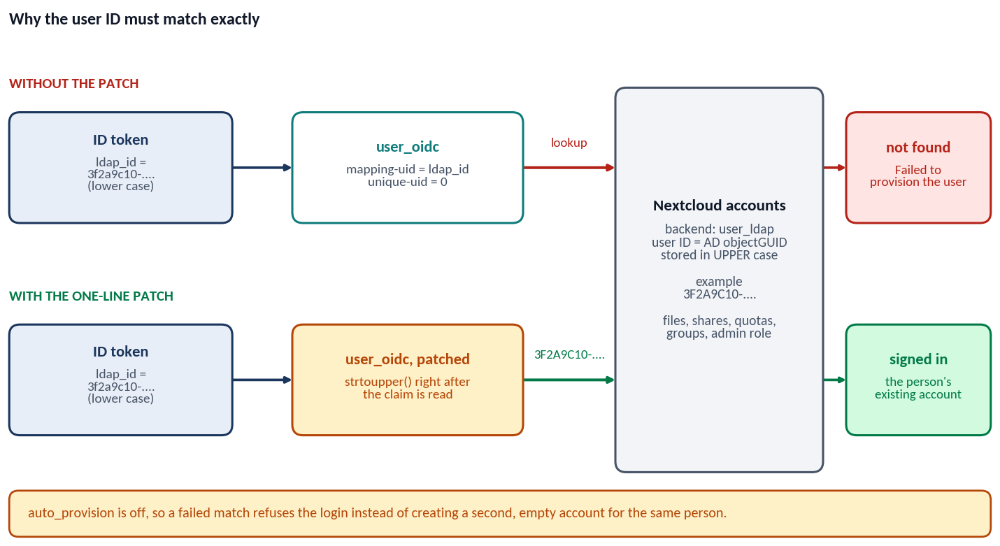

# Nextcloud — OpenID Connect on top of an LDAP user base

**Status:** working (needs one patch)   **Version:** Nextcloud 30.0.5, `user_oidc` 8.11.0   **Protocol:** OIDC through the official `user_oidc` app; accounts stay in LDAP (`user_ldap`)
**Automation:** [`scripts/nextcloud/`](../../scripts/nextcloud/) — `01-configure-oidc` → `02-patch-user-oidc` → `03-verify`

Nextcloud runs in a Docker container behind nginx. Its users have always signed in with their directory password through the `user_ldap` app. SSO is added with Nextcloud's official `user_oidc` app: Keycloak is registered as an OpenID Connect provider and the **directory GUID** is sent as the user ID, so each person lands in their **existing account** — files, shares, quota — instead of a new empty one.



## Why this service, why this method

`user_oidc` is Nextcloud's official OpenID Connect app; the alternatives (a SAML app, community social-login apps) were not evaluated. What makes Nextcloud different from every other service here is that **the accounts already exist**. A user ID built from the account name would create a second, empty account for each person; the app's default of hashing or prefixing user IDs would never match; and a difference in letter case fails the lookup. The first two were designed out before the first login; the third is [the patch](#the-case-problem-and-the-one-line-patch).

## Prerequisites

- Nextcloud with `user_ldap` accounts whose internal user IDs are the AD `objectGUID` in upper case (check: `occ user:list` shows IDs like `3F2A9C10-…`).
- Keycloak with the AD provider *and* the `LDAP_ID` attribute available (it is, for every imported user).
- nginx in front of Nextcloud, DNS and certificate for `NEXTCLOUD_HOSTNAME`.
- The container name (`NEXTCLOUD_CONTAINER`, `app` in the original build) and `docker exec` rights on the host.

## 1. Keycloak side

| Setting | Value |
|---|---|
| Client ID | `nextcloud` |
| Client type | OpenID Connect, **Client authentication on**, standard flow only |
| Valid redirect URIs | `https://<NEXTCLOUD_HOSTNAME>/apps/user_oidc/code` |
| Valid post logout redirect URIs | `https://<NEXTCLOUD_HOSTNAME>/` |
| Mapper (dedicated scope) | type **User Attribute**: attribute `LDAP_ID`, token claim `ldap_id`, type String, in ID token, access token and userinfo |

Keycloak keeps each imported directory user's GUID in `LDAP_ID`. Evaluate the claim for one user (*Clients → nextcloud → Client scopes → Evaluate*) and compare it with the Nextcloud user list: the two values are **identical apart from letter case** — lower case in Keycloak, upper case in Nextcloud.

## 2. Service side

[`01-configure-oidc.sh`](../../scripts/nextcloud/01-configure-oidc.sh) does the following through `occ`:

| Setting | Why |
|---|---|
| `occ app:install user_oidc` | the official app (8.11.0 on Nextcloud 30.0.5) |
| `overwriteprotocol` = `https` | Nextcloud sits behind nginx and would otherwise build an `http://` return address, which Keycloak refuses |
| `user_oidc` → `auto_provision` = `false` | a sign-in that matches no existing account is **refused** instead of creating an empty duplicate |
| provider `keycloak` with `--mapping-uid=ldap_id --unique-uid=0` | send the AD GUID; `unique-uid` at its default hashes or prefixes user IDs and would never match the LDAP accounts |

Display-name and e-mail mappings are left out on purpose, so the values the LDAP app maintains stay untouched. **Group synchronisation is left off too:** the OIDC apps rewrite a user's whole group list at every login when it is on, which could strip the existing `admin` group from the administrators.

### The case problem and the one-line patch

**Symptom.** Keycloak authenticated the user and redirected back, and Nextcloud answered *Access forbidden: Failed to provision the user*. No account was created — `auto_provision=false` doing its job.

**Cause.** The ID arrives in lower case, the accounts are stored in upper case, and the lookup is case-sensitive. Two checks confirmed it:

```bash
docker exec -u www-data app php occ user:info 3f2a9c10-....   # user not found
docker exec -u www-data app php occ user:info 3F2A9C10-....   # account shown
```

…and Keycloak's *Evaluate* screen shows the lower-case claim. The same message is also shown when the claim is **missing altogether**, so first check that the provider's mapping saved as intended (`occ user_oidc:provider keycloak`).

**Fix.** One line in the app's `LoginController.php`, directly after the user ID claim is read, converts the ID to upper case before the lookup ([illustration](../../config/nextcloud/user_oidc-uppercase-uid.diff.example)):

```php
if ($userId !== null) { $userId = strtoupper($userId); }
```

[`02-patch-user-oidc.sh`](../../scripts/nextcloud/02-patch-user-oidc.sh) applies it with [`patch_login_controller.py`](../../scripts/nextcloud/patch_login_controller.py): it refuses unless the anchor line exists **exactly once**, keeps the pristine file as `LoginController.php.orig`, checks the result with `php -l` and is idempotent. The tool is unit-tested against a fixture ([tests](../../tests/run-tests.sh)).

> **An update of the `user_oidc` app replaces the file and removes the patch.** Re-run `02-patch-user-oidc.sh` after every update of the app, then sign in once.

**What was not done, and why:**

- *Loosening the database collation* would make the lookup succeed, but the application would then treat the lower-case ID as the user, and files, shares and settings keyed by the upper-case ID could end up under a **second identity**.
- *The app's `AttributeMappedEvent`* exists for custom mapping, but the app dispatches it from its provisioning code, so with `auto_provision` off a listener may never run. Not pursued.
- *A Keycloak mapper that emits the GUID in upper case* is the cleaner long-term fix and removes the patch. Keycloak's built-in mappers cannot change letter case, so this needs a custom or script mapper (**not tried**).

## 3. Verify

```bash
TEST_UID=<an existing user ID> bash scripts/nextcloud/03-verify.sh
```

It checks the app, the provider mapping, `auto_provision`, `overwriteprotocol`, the patch, the redirect to Keycloak (with an `https` return address) and the fallback address. Then, in a private window: **Login with keycloak** → sign in as an existing administrator → you must land in the **existing account** (files and administration settings present), not an empty one. `occ user:list | grep -i <user>` must still show **one** entry for the person.

## 4. Logout

The failed attempts left a **stale Nextcloud session** in the browser, and pressing Logout then produced a **CSRF error**, so the user was locked out of logging out. Clearing the site's cookies (or a private window) removed it. After the patch, login and logout both worked. The post-logout address registered in section 1 is what lets Keycloak return the browser to Nextcloud. Nextcloud talks to Keycloak directly, so the [Knox logout addresses](knox.md#one-logout-address-per-application) are not used.

## 5. Access control

- **Existing administrators keep their rights:** group sync is off, so the Nextcloud `admin` group is untouched.
- **Making SSO the main login (optional):** `occ config:app:set --value=0 user_oidc allow_multiple_user_backends` redirects straight to Keycloak. Until then the login page shows the password form and a Keycloak button, and directory users can still sign in with their AD password through `user_ldap`. **Unverified** for this deployment.
- **Local administrator (break-glass):** a local `admin` exists in the Database backend. `https://<NEXTCLOUD_HOSTNAME>/login?direct=1` shows the normal form even when the redirect is on ([break-glass.md](../break-glass.md)); `occ user:resetpassword admin` resets a lost password.
- **Who may sign in:** everyone the LDAP user filter admits. Not restricted.

## 6. Bugs we hit

| # | Symptom | Cause | Fix |
|---|---|---|---|
| 32 | *Failed to provision the user* after a good Keycloak login | Lower-case GUID from Keycloak against upper-case stored IDs; the lookup is case-sensitive | One-line `strtoupper` patch in `user_oidc` |
| 33 | CSRF error when logging out after the failed attempts | A stale session in the browser | Clear the site cookies or use a private window |

Also in [troubleshooting.md](../troubleshooting.md).

## 7. Workarounds and shortcuts

- **A patched third-party app** (`user_oidc`): re-apply after every update. This is the one place where the build modifies code it does not own.
- `auto_provision` stays **off**; turning it on while the case problem exists would create a duplicate account for every user.
- `overwriteprotocol=https` is set globally.

All listed in [post-install-changes.md](../post-install-changes.md).

## 8. Open items

- Replace the patch with a Keycloak mapper that emits the GUID in upper case.
- **Nextcloud 30.0.5 is old.** Plan an upgrade and check afterwards that a compatible `user_oidc` and the patch still apply.
- Housekeeping found on the way: the LDAP **user filter** also admits Exchange system mailboxes as Nextcloud users, and the LDAP **login filter** accepts more than sixty attributes as a login name. Neither blocks SSO; both can be narrowed.
- Decide on `allow_multiple_user_backends` (SSO as the main login).
