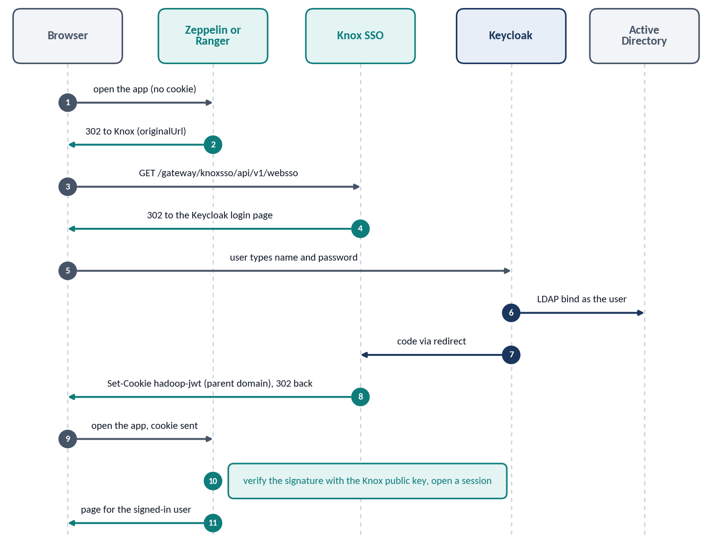
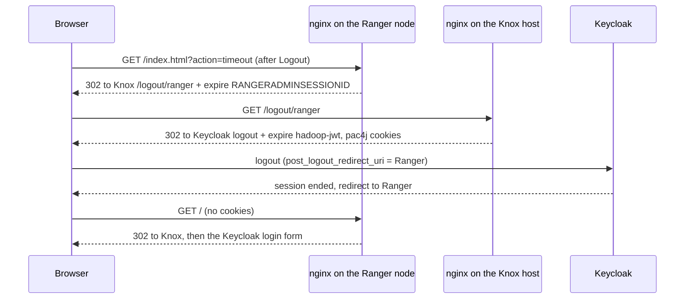

# Apache Ranger — Knox JWT integration

**Status:** working   **Version:** 2.6.0 (distribution packages, Rocky Linux 9)   **Protocol:** via the Knox JWT cookie (Ranger has no Keycloak client of its own)
**Automation:** [`scripts/ranger/`](../../scripts/ranger/) — `00-preflight` → `01-configure-knox-sso` → `02-setup-nginx` → `03-verify`

Ranger Admin runs on its own node behind nginx. It reuses the Knox login exactly as [Zeppelin](zeppelin.md) does: an unauthenticated browser is sent to Knox, Ranger trusts the signed `hadoop-jwt` cookie that comes back, and **Ranger never talks to Keycloak**. Login, logout, administrator roles and a local-administrator fallback all work.

## Why this service, why this method

Ranger ships a Knox SSO filter, configured through `ranger.sso.*` properties in `ranger-admin-site.xml`. It needs no code and no extra libraries, which is the lesson of [Zeppelin's failed first attempt](zeppelin.md#the-failed-first-attempt-direct-oidc-in-zeppelin) applied again: **use the integration the product already has**. The Knox certificate Zeppelin trusts is the trust anchor. Direct OIDC in Ranger was not evaluated (**unverified** whether this version offers it).

The login sequence is the one in [architecture.md](../architecture.md#login-sequence-for-zeppelin-the-longest-chain); only the application at the start differs.



## Prerequisites

- [Knox login works](knox.md) (phase 4). **Nothing changes in Knox or Keycloak for the login itself:** the redirect whitelist and the cookie domain (`.${DOMAIN}`) already cover the Ranger host.
- Knox's PEM certificate copied to the Ranger node (`KNOX_CERT_FILE`, the same file Zeppelin uses as `knox-sso.pem`).
- DNS record for `RANGER_HOSTNAME`; the wildcard certificate and key on the node; the local Ranger `admin` password at hand (it is the [break-glass login](../break-glass.md)).
- Root on the Ranger node. nginx is installed by the script.

## 1. Keycloak side

No new client. Add **one value** to the existing client `knox`:

| Setting | Value |
|---|---|
| Client | `knox` (see [knox.md](knox.md)) |
| Valid post logout redirect URIs | add `https://<RANGER_HOSTNAME>/` |

Without it Keycloak ends the logout chain with an *invalid redirect URI* error. The Knox host also needs its own logout address for Ranger — [`/logout/ranger` in `knox.conf.example`](../../config/nginx/knox.conf.example), generated for any further application by [`gen-app-logout.sh`](../../scripts/tools/gen-app-logout.sh).

## 2. Service side

Run [`00-preflight.sh`](../../scripts/ranger/00-preflight.sh) first. It is read-only and checks the three things that cost time in the original build.

### 2.1 Find the live configuration

A search for `ranger-admin-site.xml` returned only `conf.dist` copies and the first `grep` read the **packaged template**. On this packaging `/etc/ranger/admin/conf` is a symlink (through `/etc/alternatives`) to `conf.dist`, so **`conf.dist` is the directory Ranger really reads**. Confirm what the running process uses before editing:

```bash
ps -o args= -p <RANGER_PID> | tr ' ' '\n' | grep -iE 'conf|ews'
readlink -f /etc/ranger/admin/conf
```

**A stale attempt was already in the live file.** SSO was enabled, but `ranger.sso.providerurl` pointed at a different identity service on another port and `ranger.sso.publicKey` held a certificate that does not belong to Knox, so every browser was redirected there. The settings were *replaced*, not extended.

### 2.2 Point Ranger at Knox

Template: [`config/ranger/ranger-sso.properties.example`](../../config/ranger/ranger-sso.properties.example). [`01-configure-knox-sso.sh`](../../scripts/ranger/01-configure-knox-sso.sh) backs the file up, edits it through [`xml_props.py`](../../scripts/lib/xml_props.py) and restarts Ranger.

| Property | Value |
|---|---|
| `ranger.sso.enabled` | `true` |
| `ranger.sso.providerurl` | `https://<KNOX_HOSTNAME>/gateway/knoxsso/api/v1/websso` |
| `ranger.sso.publicKey` | the Knox certificate body on **one line**, without the BEGIN/END lines (`<KNOX_CERT_BASE64>`) |
| `ranger.sso.cookiename` | `hadoop-jwt` |
| `ranger.sso.query.param.originalurl` | `originalUrl` |
| `ranger.sso.browser.useragent` | `Mozilla,chrome` — user agents containing these words are treated as browsers and redirected to Knox |
| `ranger.externalurl` | `https://<RANGER_HOSTNAME>` |

The editor is deliberately dumb and safe: each property must match **exactly once** (none: added; several: the run aborts), the result must still parse as XML, and a second run changes nothing. A hand edit of a one-line certificate key is easy to get wrong — the script prints `replaced`, `added` or `unchanged` for every property so nothing is silent.

A stop can take about a minute (the old process is force-killed after its grace period), so wait two minutes before testing. A browser user agent must now be redirected to Knox:

```bash
curl -s -o /dev/null -w '%{http_code} -> %{redirect_url}\n' -A "Mozilla/5.0 Chrome" http://localhost:6080/
# 302 -> https://<KNOX_HOSTNAME>/gateway/knoxsso/api/v1/websso?originalUrl=...
```

> **Two copies of one certificate.** Ranger now holds a copy of Knox's self-signed certificate next to Zeppelin's. Refresh **both** when Knox's certificate is replaced (valid until October 2027).

### 2.3 The restart that failed for an unrelated reason

The first restart looped: the service failed to start every 15 seconds and the journal said only *"failed to start"*. The cause was in **`catalina.out`**, not the journal. Ranger's JVM is started with a Prometheus **JMX exporter** java agent (configured in `ranger-admin-env-jmx.sh`). The agent could not open its rules file (`/opt/jmx_exporter/ranger-jmx.yml`), and **a missing rules file makes the agent terminate the whole JVM**.

Restoring the original configuration did not help — which proved the SSO edit was innocent. Creating the rules file fixed it; the minimal content exports every metric and the exporter then answers on its port:

```bash
mkdir -p /opt/jmx_exporter
printf 'rules:\n  - pattern: ".*"\n' > /opt/jmx_exporter/ranger-jmx.yml
curl -s localhost:7073/metrics | head -3
```

Why the file was missing was **not determined**; check that no synchronisation job removes it from `/opt/jmx_exporter`. `00-preflight.sh` now reports this before a restart can hurt.

> **Lesson.** When a restart fails after a configuration change, put the old configuration back and restart. If it still fails, the change was not the cause.

### 2.4 Publish through nginx

[`02-setup-nginx.sh`](../../scripts/ranger/02-setup-nginx.sh) installs nginx, places the certificate, renders [`config/nginx/ranger.conf.example`](../../config/nginx/ranger.conf.example), turns on the SELinux boolean (6080 is not an allowed web port, the same cause as [problem 4](../troubleshooting.md)) and reloads. The node's host firewall was **not running**, so no firewall rule was needed.

Ranger builds the return address it hands to Knox from `X-Forwarded-Proto` and `X-Forwarded-Host`. **`X-Forwarded-Port` is left out on purpose**, otherwise the address gains `:443`. Expected:

```bash
curl -sk -o /dev/null -w '%{http_code} -> %{redirect_url}\n' -A "Mozilla/5.0 Chrome" https://<RANGER_HOSTNAME>/
# 302 -> https://<KNOX_HOSTNAME>/gateway/knoxsso/api/v1/websso?originalUrl=https://<RANGER_HOSTNAME>/
```

If the original address shows `http://` or `localhost`, the forwarded headers are not reaching Ranger.

## 3. Verify

```bash
bash scripts/ranger/03-verify.sh      # from any host; read-only
```

It checks login redirect, the logout rule (status, `Location`, expired `RANGERADMINSESSIONID`), the Knox-side logout address (Keycloak redirect, return to Ranger, expired `hadoop-jwt`), `/locallogin` and the JMX exporter. Then, by hand, in a private window:

1. Open `https://<RANGER_HOSTNAME>` → Keycloak login → back in Ranger as the directory user.
2. **Logout**, then sign in as a *different* user → the name at the bottom of the left sidebar changes.
3. `https://<RANGER_HOSTNAME>/locallogin` → Ranger's own login form → `admin` works.

## 4. Logout

With SSO on, Ranger's Logout button does not call a logout endpoint. The browser requests `/service/plugins/checksso` and then navigates to **`/index.html?action=timeout`**. Ranger ends its own session, but `hadoop-jwt` and the Keycloak session survive, so the SSO filter signs the same user in again within seconds — the loop from [the three sessions](../architecture.md#sessions-you-have-to-think-about-important-for-logout).

No Ranger setting for where Logout should go was found, so the fix **hooks that landing URL in nginx**:



**The first version looked right and still failed.** The rule sent the browser through Knox and Keycloak, but the user came back signed in. The intercepted request never reached Ranger, so **Ranger's own session cookie `RANGERADMINSESSIONID` was never ended**. The rule has to expire that cookie in the same response; Ranger sets it without the `Secure` attribute, so the expiry uses the same attributes. The nginx access log made the sequence visible: a `checksso` request, then the `index.html?action=timeout` request answered with a 302.

A session **timeout** lands on the same URL, so a timeout now performs a full logout. This is intended.

## 5. Access control

- **First sign-in creates the user** with the basic user role, so every future administrator must sign in once before being promoted.
- **Local administrator.** `https://<RANGER_HOSTNAME>/locallogin`, opened in a **private window** (no `hadoop-jwt` cookie), redirects to `/login.jsp` and accepts the built-in `admin` account although SSO is on (`ranger.authentication.method` is `LDAP`). **Verified.** This is the break-glass path ([break-glass.md](../break-glass.md)).
- **Promoting users.** Settings → Users/Groups → the user → *Role: Admin*. For users created by SSO this form **cannot be saved**: *First Name* is required but the field is disabled. The workaround is to update the user through Ranger's REST API as the local administrator: read the user record, set the role list to `ROLE_SYS_ADMIN`, fill the first name if it is empty, and send the whole record back to the user-update route. A first guess at a dedicated role endpoint returned HTTP 404 on this version, so it is not a route to rely on. **Unverified:** the exact route is described from the product's behaviour — read each role back to confirm it.
- `ranger.usersync.group.based.role.assignment.rules` was empty, so usersync does not overwrite roles set by hand.
- **Every enabled directory user** can sign in (as a basic user). Restricting by Keycloak group is open ([security-checklist](../security-checklist.md)).

## 6. Bugs we hit

| # | Symptom | Cause | Fix |
|---|---|---|---|
| 25 | Browsers sent to an unknown address after SSO was switched on | A stale SSO attempt (other provider, other key) was already in the live file | Replace the three values with the Knox ones (2.2) |
| 26 | Edits seemed to have no effect | First read was the packaged template; the live directory is a symlink to `conf.dist` | Check the process class path and the symlink first (2.1) |
| 27 | First restart loops, failing every 15 s | JMX exporter agent cannot open its rules file and ends the JVM | Create the rules file; read `catalina.out`, not only the journal (2.3) |
| 28 | Logout returns to the UI, still signed in | Knox cookie and Keycloak session survive; the UI lands on `index.html?action=timeout` | nginx rule on that URL plus a Knox logout address for Ranger (4) |
| 29 | After the first rule the user still came back signed in | The intercepted request never reached Ranger, so its own session cookie survived | Expire `RANGERADMINSESSIONID` in the same response (4) |
| 30 | An SSO user cannot be promoted to Admin in the UI | *First Name* is required but disabled for externally created users | Update the user through the REST API as the local admin (5) |

Rows are also in [troubleshooting.md](../troubleshooting.md).

## 7. Workarounds and shortcuts

- The logout fix is an **nginx rule**, not a Ranger setting: it depends on the UI landing on `/index.html?action=timeout`. Re-check after a Ranger upgrade.
- Role promotion goes through the REST API because the UI form cannot be saved for SSO users.
- The JMX rules file was created by hand (monitoring).
- Port 6080 stays open to every host (Ranger plugins and usersync fetch policies there), and a browser can use it to bypass nginx and TLS. No host firewall runs on the node.

All listed in [post-install-changes.md](../post-install-changes.md).

## 8. Open items

- Restrict **6080** to the plugin and usersync hosts and start a host firewall on the node.
- Restrict who may sign in by Keycloak group (all enabled directory users can today).
- Map Keycloak groups to Ranger roles instead of promoting users one by one (**not tried**).
- Verify the REST promotion route on this version and document it exactly.
- Refresh the Knox certificate copy in Ranger and Zeppelin before October 2027.
